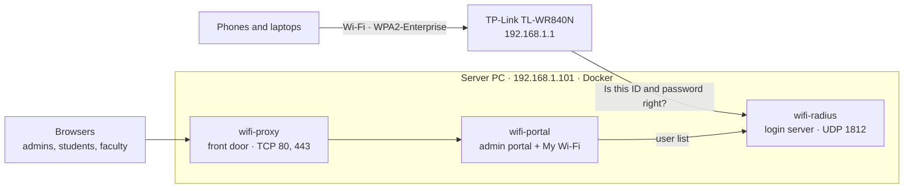

# Setup guide

One-time setup of the CCE Skills Clinic Wifi Admin Portal: the login server and portal in Docker,
the first admin, and the TP-Link router. Plan for about 45 minutes. Works on **Windows** (Docker
Desktop) and **Linux** (for example a Raspberry Pi 4/5 with a 64-bit OS, or any small PC).

After setup:

- [Using the portal](USING.md): Wi-Fi users, CSV import, My Wi-Fi, admins, joining from devices.
- [Maintenance](MAINTENANCE.md): backups, updates, moving the server, security notes, troubleshooting.

## How it fits together



The optional `wifi-certs` and `wifi-tunnel` containers (steps 11 and 12) are in the table below.

| Container | What it does |
|---|---|
| `wifi-radius` | The login server (FreeRADIUS). The router asks it whether a Wi-Fi ID and password are right. |
| `wifi-portal` | The website. Admins manage Wi-Fi users; students and faculty use **My Wi-Fi**. Same sign-in page. |
| `wifi-proxy` | The portal's front door on ports 80 and 443. HTTPS once step 11 is done. |
| `wifi-certs` | Optional (step 11): gets and renews a Let's Encrypt certificate. Idle until then. |
| `wifi-tunnel` | Optional (step 12): serves the portal through Cloudflare, with an "offline" page. Not started until then. |

## Steps at a glance

| Step | | |
|---|---|---|
| 1 | [Check what you need](#1-check-what-you-need) | Required |
| 2 | [Connect the server and fix its address](#2-connect-the-server-and-fix-its-address) | Required |
| 3 | [Install Docker](#3-install-docker) | Required |
| 4 | [Get the project](#4-get-the-project) | Required |
| 5 | [Run setup](#5-run-setup) | Required |
| 6 | [Create the first admin](#6-create-the-first-admin) | Required |
| 7 | [Open the portal from another device](#7-open-the-portal-from-another-device) | Required |
| 8 | [Add yourself as a Wi-Fi user](#8-add-yourself-as-a-wi-fi-user) | Required |
| 9 | [Switch the router to WPA2-Enterprise](#9-switch-the-router-to-wpa2-enterprise) | Required |
| 10 | [Join the Wi-Fi and check](#10-join-the-wi-fi-and-check) | Required |
| 11 | [A publicly trusted certificate (Let's Encrypt)](#11-optional-a-publicly-trusted-certificate-lets-encrypt) | Optional |
| 12 | [An offline page through Cloudflare Tunnel](#12-optional-an-offline-page-through-cloudflare-tunnel) | Optional |

Each step ends with a **Check**. Don't move on until it passes; the
[troubleshooting table](MAINTENANCE.md#troubleshooting) covers the usual problems.

---

## 1. Check what you need

| | |
|---|---|
| A machine that stays on | Windows 10/11 or Linux, 2 GB RAM is plenty. If it's off, nobody new can join the Wi-Fi. |
| A network cable | The server must be **wired**, not on Wi-Fi: once the Wi-Fi asks for logins, a server on Wi-Fi couldn't log itself in. |
| The router | The TP-Link TL-WR840N and its admin password. Another router works if it supports WPA2-Enterprise ([Using another router](MAINTENANCE.md#using-another-router-or-more-than-one)). |
| The project folder | This repository. If you're moving an existing install, follow [Moving to another machine](MAINTENANCE.md#moving-to-another-machine) instead. |
| For steps 11 and 12 only | A domain whose DNS is on **Cloudflare** (this install uses `riomar.dev`). |

## 2. Connect the server and fix its address

The router finds the login server by its IP address, so the address must never change.

1. Plug the server into one of the **router's LAN ports** with a cable. (The modem works too; then
   make the reservation below in the modem instead.)
2. Find the server's address and its **Ethernet** adapter's MAC address:
   - Windows: `ipconfig /all`. Under **Ethernet adapter Ethernet**, note **Physical Address**
     (e.g. `E4-A8-DF-…`) and **IPv4 Address** (e.g. `192.168.1.101`).
   - Linux: `ip -4 addr` and `ip link`.
   Use the Ethernet adapter's MAC, not the Wi-Fi one: each adapter has its own.
3. In the router at `http://192.168.1.1` → **DHCP → Address Reservation → Add New**:
   the MAC address, the reserved IP (e.g. `192.168.1.101`), Status **Enabled** → **Save**.
4. Reboot the router once so the reservation takes effect.

Leave the server on **Obtain an IP address automatically**; the router now always gives it the same address.

**Check:** after the reboot, `ipconfig` (or `ip -4 addr`) shows the reserved address.

## 3. Install Docker

### Windows

1. Install **Docker Desktop** from <https://www.docker.com/products/docker-desktop/> (it sets up WSL 2).
2. Open Docker Desktop → **Settings → General** → tick **Start Docker Desktop when you sign in**.
3. Install **PowerShell 7** if `pwsh` doesn't run yet: `winget install Microsoft.PowerShell`.
4. Stop the PC from sleeping when plugged in:
   ```powershell
   powercfg /change standby-timeout-ac 0
   ```

### Linux

```bash
curl -fsSL https://get.docker.com | sh
sudo usermod -aG docker $USER      # then sign out and back in
```

Docker starts on boot by itself, and the containers restart with it.

**Check:** `docker version` shows a **Server** version.

## 4. Get the project

Copy the project folder to the server, or clone it:

```bash
git clone <repository-url> skills-clinic-wifi-portal
cd skills-clinic-wifi-portal
```

**Check:** the folder contains `setup.ps1`, `setup.sh` and `compose.yaml`.

## 5. Run setup

In the project folder:

```powershell
.\setup.ps1        # Windows, PowerShell 7
```

```bash
sh setup.sh        # Linux
```

The first run takes a few minutes because it builds the images. It:

1. creates the **certificate** for the login server (`data/certs/`, valid 10 years). Phones
   remember it, so never delete it.
2. creates the **router secret** (`data/clients.conf`). The router needs it in step 9.
3. starts the containers.
4. prints a **setup code** for the first admin.

Running it again is safe: it never replaces the certificate, the secret or any data.

> **Linux:** the portal container runs as user ID 1000. If your user isn't 1000 (`id -u`), run
> `sudo chown -R 1000:1000 data` once, or the portal can't write the user list.

**Check:** `docker compose ps` shows `wifi-radius`, `wifi-portal`, `wifi-proxy` and `wifi-certs` as **Up**.

## 6. Create the first admin

**In the browser (recommended):**

1. On the server, open **http://localhost**. You're sent to **Create the first admin**.
2. Enter the **setup code**. Setup printed it; it's also in `data/setup-code.txt`.
3. Choose an admin **username** (lowercase) and a **strong password** of at least 10 characters.
   The sign-in page is reachable from the whole network.

The code proves you have access to the server itself, so nobody else on the network can claim the
portal first. It stops working once the first admin exists.

**Or from the command line** (asks for the password twice, never shown or saved in history):

```bash
docker exec -it wifi-portal python -m app.cli add-admin <username>
```

**Check:** you're signed in, and the **Dashboard** shows the **Login server** as *Running*.

## 7. Open the portal from another device

The server must accept these from the network:

| Port | From | Why |
|---|---|---|
| UDP **1812** | The router | Wi-Fi logins |
| TCP **80** and **443** | The network | The portal (443 once it has HTTPS, step 11) |

- **Windows:** Docker Desktop's firewall rule ("Docker Desktop Backend") allows its ports on networks
  set to **Public**. If the server's network is set to **Private**, add inbound rules for UDP 1812,
  TCP 80 and TCP 443 in **Windows Security → Firewall → Advanced settings**.
- **Linux:** Docker opens published ports itself, even past `ufw`. Nothing to add unless another
  firewall sits in front.

**Check:** on a phone connected to the router's Wi-Fi (still the old Wi-Fi password at this
point), open `http://192.168.1.101` (the server's address). The sign-in page loads.

## 8. Add yourself as a Wi-Fi user

Do this **before** switching the router in step 9, or nobody (including you) can join afterwards.

1. Portal → **Wi-Fi users → Add Wi-Fi user**.
2. Fill in your **Student ID / Faculty ID** (your Wi-Fi username, lowercase), name and UMindanao
   email. Click **Generate** for a password, or type your own (8-64 characters).
3. **Add user**, and note the password: it's shown only once.

Adding everyone else, CSV import and expiry: [Using the portal](USING.md#managing-wi-fi-users).

**Check:** you're in the **Wi-Fi users** list as **Active**.

## 9. Switch the router to WPA2-Enterprise

In the TP-Link at `http://192.168.1.1`:

1. **WPS → Disable WPS.** Enterprise mode doesn't work while WPS is on.
2. **Wireless → Wireless Settings:** set the network name to **CCE Skills Clinic WiFi** and save.
   The portal's QR codes use this name; to use another, see
   [Using another router](MAINTENANCE.md#using-another-router-or-more-than-one).
3. In the portal: **Server → Show secret**, enter your admin password, and copy the secret.
4. **Wireless → Wireless Security → WPA/WPA2 - Enterprise**:
   - Version **WPA2**, Encryption **AES**
   - RADIUS Server IP: the server's address from step 2 (e.g. `192.168.1.101`)
   - RADIUS Server Port: **1812**
   - RADIUS Server Password: the secret you copied
5. **Save.** Every device on the Wi-Fi disconnects and must rejoin with its own ID and password.

Also change the router's own admin password from the default (**System Tools → Password**, or
**System Tools → Administration** on newer firmware).

**Check:** the router's Wireless Security page shows WPA/WPA2 - Enterprise with your server's address.

## 10. Join the Wi-Fi and check

On a phone, join **CCE Skills Clinic WiFi** with the ID and password from step 8:

- **iPhone / Mac:** enter the ID and password, then tap **Trust**.
- **Android:** EAP **PEAP**, Phase 2 **MSCHAPV2**, CA certificate **Trust on first use**,
  Identity = your ID. Domain, if asked: `wifi.skillsclinic.local`.
- **Windows:** enter the ID and password, then **Connect**.

Devices ask once to trust the certificate because it was made in step 5. Check it says
**wifi.skillsclinic.local** before trusting it. Step 11 removes the question on Android.

**Check:** the phone connects and has internet, and in the portal your page (**Wi-Fi users** →
you) shows the attempt as **Accepted** under **Recent connections**.

**The required setup is done.** Now:

1. **Make a first backup:** portal → **Server → Download backup**, and copy the `data` folder
   somewhere safe ([Backups](MAINTENANCE.md#backups)).
2. Add everyone else ([Using the portal](USING.md#managing-wi-fi-users)).
3. Share the portal address (`http://192.168.1.101`, or `https://wifi.riomar.dev` after step 11) so
   students and faculty can use **My Wi-Fi**.

---

## 11. Optional: a publicly trusted certificate (Let's Encrypt)

**What you get:**

- **Android** connects with **Use system certificates** and no warning. iPhones, Macs and Windows
  still ask once: an iPhone shows **Not Trusted** for every Wi-Fi certificate it hasn't seen, even
  a Let's Encrypt one. That's normal; tap **Trust** if it shows your name (e.g. `wifi.riomar.dev`)
  issued by Let's Encrypt (`R…` or `YR…`).
- **The portal gets HTTPS:** `https://wifi.riomar.dev` instead of `http://<server>`, so sign-ins are
  encrypted on the wired network too.

**Trade-off:** the certificate renews automatically about every two months. Android doesn't notice,
but iPhones, Macs and Windows may ask to **Trust** again after a renewal. If that bothers your users
more than the one-time warning, skip this step.

The server does **not** need to be reachable from the internet: `wifi-certs` proves you own the
domain by adding a temporary DNS record through Cloudflare's API, then removes it.

### 11a. Make a Cloudflare API token

1. <https://dash.cloudflare.com> → profile icon (top right) → **My Profile → API Tokens → Create Token**.
2. **Token name:** `wifi-certs`.
3. Click the **Edit zone DNS** card. Leave **Permissions** as `Zone · DNS · Edit`, and set
   **Zone Resources** to `Include · Specific zone · riomar.dev` (your domain).
4. **Token expiration:** No expiration. **Client IP address filtering:** leave empty.
5. **Continue to summary → Create Token**, then **Copy** the token. Cloudflare shows it only once.

The token can only edit DNS for that one domain. Never paste it into chat, email or the repository.

### 11b. Put the token and name on the server

In the project's `letsencrypt` folder (setup created it; Git ignores it), create two text files:

| File | Contents (one line) |
|---|---|
| `letsencrypt/cloudflare.ini` | `dns_cloudflare_api_token = <the token>` |
| `letsencrypt/domain` | the name for the certificate, e.g. `wifi.riomar.dev` |

In Notepad use **Save as type: All files (\*.\*)**, or the file ends up as `cloudflare.ini.txt`.
On Linux, `chmod 600 letsencrypt/cloudflare.ini`.

### 11c. Add the DNS record

Once the certificate exists, every `http://` visit to the portal, even by IP address, is redirected
to `https://<the name>`, so the name must lead to the server **first**. In Cloudflare: your domain →
**DNS → Records → Add record**:

| Type | Name | IPv4 address | Proxy status |
|---|---|---|---|
| `A` | `wifi` | the server's address, e.g. `192.168.1.101` | **DNS only** (grey cloud) |

It must be **DNS only**: Cloudflare's proxy can't reach a private address. The record only works on
your own network and reveals nothing beyond that private address. (Step 12 replaces it.)

**Check:** `nslookup wifi.riomar.dev 1.1.1.1` answers the server's address.

### 11d. Test, then turn it on

1. Test the token and name without getting a real certificate:
   ```bash
   docker compose build certs
   docker compose run --rm certs once --dry-run
   ```
   It should end with **Dry run worked**.
2. Run setup again (step 5). `wifi-certs` gets the certificate within a minute or two, and the
   login server restarts by itself to use it (a few seconds; connected devices stay on):
   ```bash
   docker compose logs certs --tail 20     # "Installed the certificate for wifi.riomar.dev"
   docker compose logs radius --tail 20    # "Using the Let's Encrypt certificate"
   ```
3. Devices that joined before must **forget the network and join again**, because the certificate
   changed. On Android: EAP **PEAP**, Phase 2 **MSCHAPV2**, CA certificate **Use system
   certificates**, Domain **wifi.riomar.dev**, Identity = ID.

**Check:** portal → **Server** shows the certificate as **publicly trusted**, and
`https://wifi.riomar.dev` opens with a padlock. `http://<server>` redirects there, so old bookmarks
keep working.

`wifi-certs` checks twice a day and renews in the certificate's last 30 days; the login server and
`wifi-proxy` pick up a renewal by themselves. To undo this step, see
[Turning off the optional extras](MAINTENANCE.md#turning-off-the-optional-extras).

---

## 12. Optional: an offline page through Cloudflare Tunnel

Normally a browser goes straight to the server, so when the server is off it just times out. With a
**Cloudflare Tunnel**, `wifi-tunnel` keeps a connection open from the server to Cloudflare, and
`https://wifi.riomar.dev` is served through Cloudflare. When the server is off or restarting, a small
Cloudflare Worker (`fallback/`) shows a **"Wi-Fi portal offline"** page instead of an error.

**Trade-offs. Read these first:**

- The portal becomes **reachable from anywhere on the internet**, not just the clinic.
- It **needs the internet**. If the clinic's internet is down, `wifi.riomar.dev` doesn't load even
  inside the clinic; use `https://<server address>` there and accept the name warning. Wi-Fi logins
  don't need the internet at all.
- Cloudflare decrypts and re-encrypts the portal traffic on its servers.
- Everyone inside the clinic reaches Cloudflare from the same public address, so 5 wrong passwords
  for a name, from inside the clinic, lock that name for the whole clinic for 5 minutes.
- Bonus: if the server's address changes, the DNS record no longer needs updating.

### 12a. Create the tunnel

1. <https://one.dash.cloudflare.com> → your account → **Networks → Connectors → Cloudflare Tunnels
   → Create a tunnel** (older dashboards: **Networks → Tunnels**). Choose **Cloudflared**.
2. **Name:** `wifi-portal` → **Save tunnel**.
3. Under **Choose your environment**, pick **Docker**. The command shown ends with `--token eyJ…`.
   Copy **only the long token** after `--token`.
4. Save it in the project folder as `tunnel/token`: one line, nothing else, no file extension. In
   Notepad use **Save as type: All files (\*.\*)**. Git ignores this folder. Never paste the token
   into chat or email: anyone with it can run your tunnel.
5. Run setup again (step 5). It starts `wifi-tunnel` because the token file exists.

**Check:** the dashboard shows the tunnel as **Healthy**, and `docker compose logs tunnel --tail 20`
shows `Registered tunnel connection`.

### 12b. Point the name at the tunnel

1. Cloudflare → your domain → **DNS → Records**: **delete** the `wifi` A record from step 11c.
   The tunnel can't add its own record while that one exists. `https://wifi.riomar.dev` doesn't load
   until the next step is done.
2. Back in the tunnel → **Published application routes** (older dashboards: **Public hostnames**)
   → **Add**:

   | Field | Value |
   |---|---|
   | Subdomain | `wifi` |
   | Domain | `riomar.dev` |
   | Path | empty |
   | Service URL | `http://proxy:8081` (older dashboards: Service type **HTTP**, URL `proxy:8081`) |

   It must be `http://proxy:8081`. Plain HTTP is fine because that hop stays inside Docker; visitors
   still get HTTPS from Cloudflare. That entrance takes the visitor's address from Cloudflare, so the
   wrong-password lock can't be dodged. `portal:8080` would let anyone fake their address, and
   `proxy:80` loops forever.
3. **Add route.** Cloudflare adds a proxied (orange cloud) `wifi` record pointing at the tunnel.

**Check:** `https://wifi.riomar.dev` loads the portal, also on a phone using mobile data.

### 12c. Deploy the offline page

Once, from any computer with Node.js (the server is fine), in the project folder:

```bash
cd fallback
npm install
npm test               # checks the page logic
npx wrangler login     # opens Cloudflare in the browser; sign in and allow access
npm run deploy
```

If your name isn't `wifi.riomar.dev`, change `routes` in `fallback/wrangler.jsonc` first. The message
is `MESSAGE` in `fallback/src/index.js`; run `npm run deploy` again after changing it. Cloudflare's
free plan runs the Worker for up to 100,000 requests a day, far more than the portal uses.

**Check:** pretend the server is off, then bring it back:

```bash
docker compose stop tunnel      # within a minute, https://wifi.riomar.dev shows "Wi-Fi portal offline"
docker compose start tunnel     # the portal is back
```

To undo this step, see [Turning off the optional extras](MAINTENANCE.md#turning-off-the-optional-extras).
